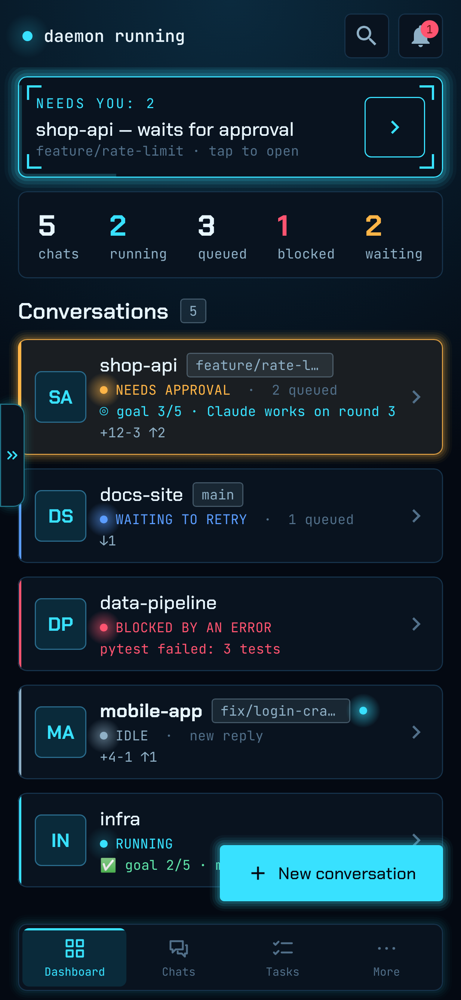
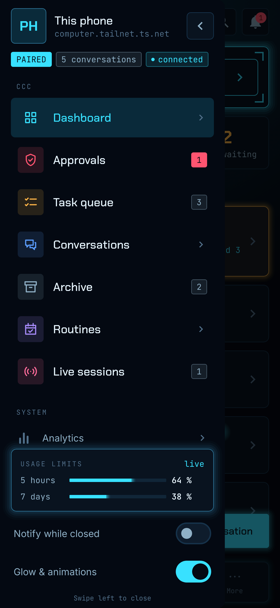
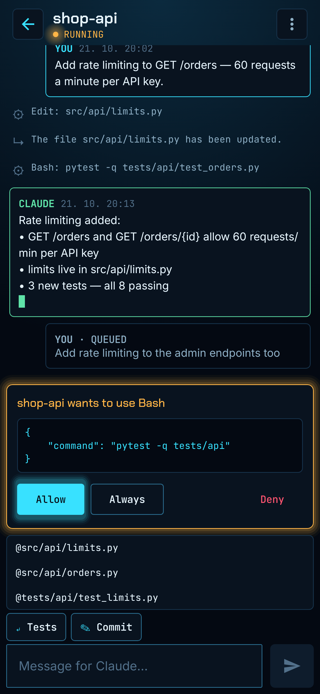

# ccc for Android

The phone client of [ccc](https://github.com/Icenux/ccc_TUI), a terminal app for working with Claude Code.
With it you can read your conversations, send messages, approve or deny tool calls, start new
conversations and check the usage limits — from your phone, privately over
[Tailscale](https://tailscale.com). It needs a running ccc on your computer with its API turned on
([how](https://github.com/Icenux/ccc_TUI/blob/main/src/ccc/help/android-api.md)).

| Dashboard | Side menu | Chat |
|---|---|---|
|  |  |  |

## Install

Android 10 or newer.

1. Download `ccc.apk` from the [latest release](https://github.com/Icenux/ccc_android/releases/latest).
2. Open it on the phone (Android asks once to allow installs from that source).
3. In ccc on the computer run `ccc api pair` (or *Settings → Devices… → Pair a new device*) and tap
   *Scan QR code* in the app.

The app holds no secret: the one-time QR code gives the phone a token made for that phone alone.

### Verify the download (optional)

```bash
sha256sum -c SHA256SUMS                                                         # the file matches the list
gpg --import release-signing-key.asc && gpg --verify SHA256SUMS.asc SHA256SUMS  # the list is signed by the maintainer
apksigner verify --print-certs ccc.apk                                          # the app is signed with the maintainer's key
```

Signing certificate SHA-256:
`81:60:8A:DC:97:06:A5:5E:B8:7D:8D:65:52:D7:2A:D8:FD:01:DE:C7:51:A3:51:BB:CF:B1:9E:58:E1:89:8D:14`;
GPG key of `SHA256SUMS.asc`: `D5AE 3DC0 F062 9B5B 97E8 1C45 6A16 DF02 11F8 C1A5`.

## Build from source

Needs JDK 17+ and the Android SDK (platform 36): `./gradlew assembleDebug`.

## Fonts

The app bundles Chakra Petch, JetBrains Mono and Inter, all under the SIL Open Font License 1.1
(copyright their authors; see the font projects for the full text).
